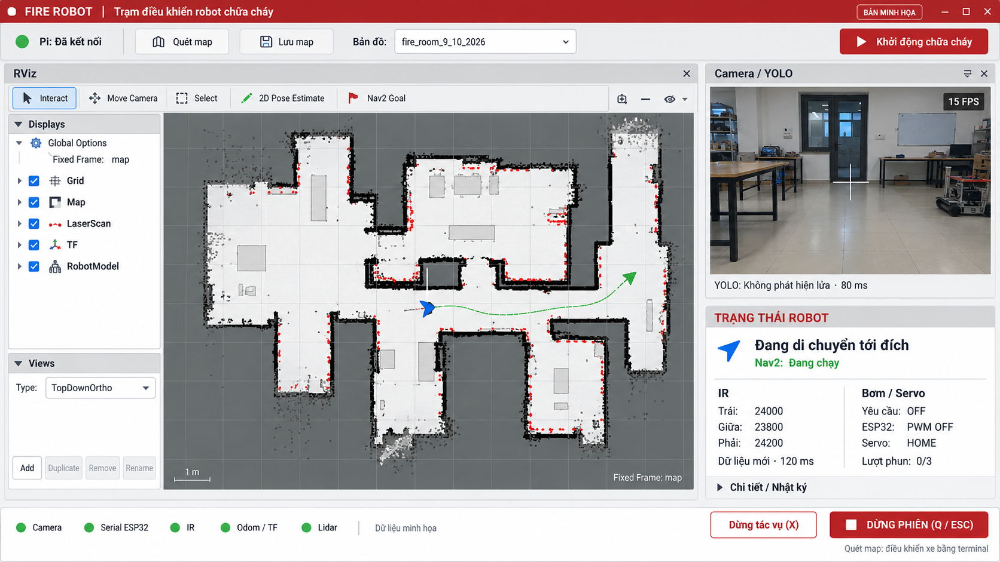

# Fire Robot Control

> **Hiện hành — 95e9facb, ngày 31/10/2026.**
> Đã sửa giữ dừng vĩnh viễn khi odom/mission/ARM hoặc query ROS trễ rồi hồi
> phục; cùng Goal/cùng identity chỉ chạy lại sau dữ liệu mới và STOP/OFF ổn
> định một giây. Recovery mission giữ wrapper app; observer có chẩn đoán pose
> chi tiết và yêu cầu mẫu AMCL thật khi xe đang đứng yên, không bỏ guard.
> **982 ca PASS, 2 SKIP theo ID duy nhất**; build/CTest/smoke gói cuối đạt.
> Static laptop/Pi 95/103 file đúng hash, đã sync LAN và chọn gói. R5 364 file,
> quét map/model/tuning nguyên byte. Bơm giữ tối đa 3 lượt liên tiếp × 6 giây
> từ ACK ON, OFF/HOME giữa lượt; hai ca bus có/không Goal đã đạt.
> Chưa thử xe/bơm thật. Pending lỗi 02:31 giữ nguyên; đóng/mở lại app, kết nối
> Pi và dùng Xác minh dừng trên robot để lấy STOP mới trước khi chạy phiên mới.
> [Bản sửa, QA và giới hạn](docs/DATA_RETURN_RECOVERY_FIX_2026-10-31.md).
> Các mục dưới là lịch sử.

> **Baseline runtime 02:21–02:31 ngày 31/10: lỗi trên 62c78ddf trước sửa.**
> QA mới có 12 FAIL chức năng: dữ liệu odom/mission/ARM trở lại vẫn giữ
> Goal dừng, gap chồng bị kẹt, và dựng lại mission bỏ qua wrapper app.
> Epoch đổi lần hai còn chờ pose; Q chưa xác nhận STOP do epoch cũ.
> [Bằng chứng, ma trận 32 ca và phạm vi](docs/QA_DATA_RETURN_0231_2026-10-31.md).
> Lượt này chưa sửa runtime; kết quả source/static bên dưới thuộc phạm vi cũ.

> **Bản trước — 62c78ddf, ngày 31/10/2026.**
> Phục hồi cùng Goal sau khi Nav2 tạm ngừng phát vận tốc trong recovery Wait:
> giữ STOP, nhận lệnh mới và proof dừng/OFF ổn định 1 giây rồi xác minh lại
> publisher mới. X/Q vẫn ưu tiên; UI hiện rõ chờ/phục hồi/giữ dừng.
> 924 ca PASS, 2 SKIP theo test ID duy nhất, gồm 112 ca phục hồi mới; CTest
> và smoke gói đạt. Static laptop/Pi 95/103 file khớp, đã sync LAN và chọn gói.
> R5 gốc, mapping, model và tuning 0,25/0,30 m giữ nguyên. Chưa thử xe thật.
> Đóng app cũ và mở lại để dùng bản mới.
> [Cơ chế, bằng chứng QA và cách thử](docs/NAV2_WAIT_RECOVERY_FIX_2026-10-31.md).

> **Bản trước — 33f9f7db, ngày 31/10/2026.**
> Giảm riêng global inflation 0,30 → 0,25 m; local giữ 0,30 m và toàn bộ
> tham số giảm tốc/va chạm, footprint/padding, R5 và mapping giữ nguyên.
> 24 ca kiểm tra và CTest đạt, static laptop/Pi 95/103 file đạt; đã sync/chọn
> gói mới. Chưa đo khoảng hở robot; đường đổi bên/vòng cua rộng vẫn OPEN.
> Đóng app cũ rồi mở lại để dùng bản mới.
> [Thay đổi và QA](docs/NAV2_GLOBAL_INFLATION_025_2026-10-31.md).
> Tag khôi phục bản 0,30 m vẫn là `desktop-inflation-030-source-pass-v1`.
> Các mục dưới mô tả mốc source và lịch sử trước thay đổi này.

> **Mốc source hiện tại — 6133ff38, ngày 30/10/2026.**
> App gom RViz/camera, quét/lưu/chọn map và quản lý phiên; Q dừng phiên,
> Esc bỏ công cụ RViz, X hủy tác vụ rồi nhận Goal mới sau khi đủ bằng chứng.
> Inflation riêng app 0,30 m, footprint 34 × 20 cm và padding 1,5 cm giữ nguyên.
> Model `best_minireplay.pt`; 364 file R5 gốc nguyên hash.
> Bản 0,30 m có 21 ca kiểm tra và CTest đạt, static laptop/Pi 95/103 file đạt;
> chưa nghiệm thu đầy đủ robot. Đường đổi bên và vòng cua rộng vẫn OPEN,
> chưa áp dụng thay đổi giữ đường hoặc lookahead.
> [Mốc khôi phục và giới hạn](docs/SOURCE_CHECKPOINT_2026-10-30.md).
> Các mục dưới là lịch sử các bản trước.

> **Hiện hành — f63e38d7: phục hồi sau cleanup Pi lỗi bằng STOP mới.**
> Xác minh dừng kiểm hiện trạng PID/lock trước khi lấy proof mới, không phụ
> thuộc cleanup lịch sử thành công. Có journal cho phiên mới khi thiếu receipt.
> 306 unittest, 289 tích hợp, CTest, smoke gói/operator localhost đạt; probe
> chỉ đọc phiên Pi lỗi thật kiểm 11 PID đạt. Đã sync LAN/static 103 file Pi,
> laptop 95 file và chọn gói. Pending cũ giữ; chưa thử STOP/khởi động lại robot.
> R5/quét map/model/Esc/Q giữ nguyên. Đóng app cũ, mở lại rồi dùng Xác minh
> dừng trên WiFi Pi; chỉ khởi động mới sau IDLE.
> [Phạm vi, QA, giới hạn và cách thử](docs/RECOVERY_QUIESCENT_FIX_2026-10-30.md).
> Các mục dưới là lịch sử.

> **Bản trước — 59bf2064: Esc bỏ công cụ RViz, chỉ Q dừng phiên.**
> 291 unittest và 253 ca tích hợp đạt; thêm 4 ca thanh Goal đạt trong lượt
> 21 kiểm tra phím cuối (17 ca đã nằm trong 253 ca trên). CTest, smoke gói
> và operator localhost đạt. Đã sync LAN Pi/static 103 file, laptop 95 file
> và chọn bản mới. R5, quét map, model và pending giữ nguyên; chưa thử robot.
> Đóng app cũ rồi mở lại để nhận phím mới. Esc không hủy goal đã gửi; dùng X.
> [Bản sửa, bằng chứng và cách thử](docs/ESCAPE_TOOL_CANCEL_Q_STOP_2026-10-30.md).
> Các mục dưới là lịch sử.

> **Bản trước — 49c68b77: điều phối Q/cleanup khi Nav2 đang reset.**
> Chờ tám node ổn định trước shutdown, xác minh FINALIZED trước SIGINT;
> STOP/watchdog và các deadline giữ nguyên. Sáu tình huống Nav2 thật cô lập,
> 291 unittest, 236 tích hợp, CTest và kiểm artifact đều đạt.
> Đã sync LAN Pi/static 103 file, laptop 95 file, chọn bản mới; R5/quét map/model
> nguyên hash. Pending cũ giữ để xác minh thật, chưa nghiệm thu robot bản mới.
> [Bản sửa, QA và cách dùng](docs/NAV2_RECOVERY_TEARDOWN_FIX_2026-10-30.md).
> Các mục dưới là lịch sử.

> **Bản trước — 5054a43e: tách lỗi vận hành khỏi xác nhận STOP.**
> Fault Nav2 vẫn giữ session rc2, nhưng không làm mất STOP đã đủ proof và cleanup
> sạch. Có log localization blockers, query và CPU/RAM riêng cho chữa cháy laptop.
> 278 unittest, 188 tích hợp, Qt CTest, smoke gói và operator thật localhost đạt;
> đã sync LAN/Pi 103 file, laptop 95 file và chọn gói. R5/map/model/pending cũ nguyên.
> **Còn lỗi Q lúc Nav2 đang reset** trong ca trễ cưỡng bức; audit tiếp tục chặn
> cleanup không sạch. Chưa chạy/nghiệm thu robot bằng bản mới.
> [Bản sửa, bằng chứng và bước thử](docs/STOP_RESULT_FIX_QA_2026-10-30.md).
> [QA bổ sung Q trong recovery](docs/QA_Q_DURING_NAV2_RECOVERY_2026-10-30.md):
> 72 ca STOP/operator đạt; Nav2 thật vẫn crash khi Q đơn hoặc lặp đúng đầu reset.
> Chưa sửa runtime hoặc chạy robot trong lượt QA bổ sung.
> Các mục dưới là lịch sử.

> **Bản trước — e2a8152b: sửa cleanup khi Q và phục hồi phiên đã STOP.**
> App đóng lifecycle Nav2 tuần tự trước SIGINT; bổ sung xác minh mới cho receipt
> STOP confirmed/Nav2 forced, và tách kết quả startup khỏi lỗi teardown.
> 266 unittest, 186 ca tích hợp đã đạt qua các lượt có ghi rõ lỗi môi trường và
> một worker sampled cần chạy lại; Nav2 thật cô lập qua startup/goal active/goal
> xong và CTest đạt. Đã sync Pi LAN/static 103 file, chọn bản mới. R5/map/model
> giữ nguyên, pending cũ giữ để xác minh thật. Chưa nghiệm thu robot.
> [Chi tiết, giới hạn và bước dùng](docs/Q_CLEANUP_FIX_QA_2026-10-30.md).
> Các mục dưới là lịch sử.

> **Hiện hành — d5209520: heartbeat tách tiến trình, ưu tiên STOP và kiểm thời gian sau query.**
> 254 unittest, 186 ca tích hợp (một ca health chạy lại riêng), Qt CTest và gói operator
> thật trên localhost đã qua. Source quét/lưu map và 364 file R5 gốc nguyên hash;
> model app giữ `best_minireplay.pt`. Bản mới chưa nghiệm thu robot thật; pending phiên
> lỗi được giữ để xác minh STOP mới. [Bản sửa, QA và giới hạn](docs/HEARTBEAT_PROCESS_FIX_QA_2026-10-30.md).
> Các mục bên dưới là lịch sử các bản trước.

> **Mới nhất — abf4aae3: xác minh STOP qua WiFi đã đạt**, app về IDLE;
> 222 unittest, 65 ca tích hợp liên quan và CTest đạt, R5 giữ nguyên.
> Quét/lưu map và chữa cháy chưa nghiệm thu trong lượt này.
> [Kết quả và giới hạn](docs/VERIFY_STOP_PASS_2026-10-30.md).

> **Mới nhất — fe47caf6 đã sửa nhận STOP và hộp xác thực:** 218 unittest /
> 161 tích hợp / CTest đạt; sync Pi và mở bản cuối. R5 giữ nguyên. STOP thật
> bằng bản cuối còn chờ nhập mật khẩu sudo trong app; pending chưa được xóa.
> [Nguyên nhân, QA và giới hạn](docs/STOP_MONITOR_AND_AUTH_RUNTIME_FIX_2026-10-30.md).

> **Mới nhất — 857b9eb3 đã sửa relay xác thực, sync và mở:** 211 unittest /
> 160 integration / CTest đạt; hộp Qt accept/cancel đi qua worker-supervisor thật.
> Lần xác minh user trước lỗi NTP refresh 100 s, chưa I/O. R5/pending nguyên;
> bản mới chờ user bấm xác minh và nhập mật khẩu Pi khi hỏi.
> [Báo cáo/giới hạn](docs/AUTH_RELAY_FIX_2026-10-30.md).

> **Mới nhất — a387d27e đã sửa và sync:** Nhánh phục hồi sau Pi reboot đã
> qua 205 unittest / 158 ca tích hợp / CTest; chuẩn bị chỉ đọc trên Pi thật đạt.
> R5/pending giữ nguyên. App mới đã mở BLOCKED, chờ user xác minh STOP mới;
> chưa I/O hoặc nghiệm thu robot. [Báo cáo và bằng chứng](docs/PI_REBOOT_RECOVERY_FIX_2026-10-30.md).

> **Sau thao tác user:** RECHECK đã nhận 6 lần nhưng thiếu STOP cũ; user thử
> Xác minh dừng cũng bị chặn bởi Pi đã reboot. Đã tái kiểm chỉ đọc ra lỗi
> RECOVERY_PI_BOOT_CHANGED; chưa I/O, chưa sửa code/xóa pending.
> [Chẩn đoán và đính chính log](docs/RECOVERY_AFTER_PI_REBOOT_DIAG_2026-10-30.md).

> **Mới nhất 30/10/2026 — app 59cddc99 đã sync Pi và được chọn:** 426 source /
> 103 installed Pi, 95 installed laptop đúng hash; R5/bộ cũ giữ nguyên. App mới
> đang mở BLOCKED do hồ sơ cũ thiếu STOP, pending giữ nguyên. Chưa runtime
> quét/chữa cháy, motion/bơm hoặc nghiệm thu WiFi. [Báo cáo và bước tiếp](docs/PI_STATIC_SYNC_2026-10-30_59cddc99.md).

> **Trước sync 30/10/2026 — ứng viên 59cddc99:** Đã sửa F1/F2/F3 và thêm
> xe nhìn từ trên xuống + đường kế hoạch Nav2. QA laptop 190 unittest,
> 158 pytest và CTest đạt; R5 giữ nguyên. Chưa sync Pi/chọn current hoặc
> nghiệm thu robot. [Báo cáo và bằng chứng](docs/FIX_AND_ROBOT_PATH_QA_2026-10-30.md).

> **QA bổ sung 30/10/2026:** Bản b3b81081 chưa đủ điều kiện đồng bộ/chọn vận
> hành: đã xác nhận 1 lỗi P1 phục hồi STOP sau seal timeout và 2 lỗi P2 bố
> cục. Code vận hành/R5/current/pending giữ nguyên trong lượt QA.
> [Báo cáo QA](docs/QA_RECHECK_SESSION1_2026-10-30.md) ·
> [Registry mới nhất](docs/QA_RECHECK_REGISTRY_2026-10-30.md).

> **Cập nhật 30/10/2026 — phiên 1:** Đã tạo ứng viên entrypoint riêng
> `b3b81081…`, giữ R5 nguyên và QA chính trên laptop. Bản mới chưa được
> chọn làm mặc định, chưa sync Pi hoặc nghiệm thu robot. Còn các ca QA
> PARTIAL/NOT_RUN và 10 lỗi fixture test R5 cũ cần xem trước khi phát hành.
> [Báo cáo và phạm vi](docs/SESSION1_APP_ENTRY_QA_2026-10-30.md) ·
> [Registry từng ca](docs/SESSION1_QA_REGISTRY_2026-10-30.md).

[Hướng dẫn quét/lưu map mở được offline](HUONG_DAN_QUET_MAP_OFFLINE.txt) — mở
sẵn file này trước khi chuyển laptop sang WiFi Pi không có Internet.

Ngày lập: **29/10/2026**, múi giờ Asia/Ho_Chi_Minh.

Mục tiêu: mở app bằng chuột, quét/lưu/chọn map và khởi động chữa cháy bằng nút;
quan sát **RViz thật và camera trong một cửa sổ**, với màu trắng–đỏ–xám theo
hướng PTIT. Khi quét map, người dùng vẫn chấp nhận lái xe bằng terminal.

## Trạng thái 29/10/2026

**Kế hoạch tiếp theo: entrypoint riêng cho app, giữ nguyên R5, mục tiêu2phiên.**
Phiên1 code + QA offline, phiên2 tích hợp Pi và nghiệm thu có giám sát.
[Kế hoạch chi tiết](docs/APP_ENTRY_AND_RECOVERY_PLAN_2026-10-29.md) và
[ma trận96 ca QA](docs/QA_APP_ENTRY_AND_RECOVERY_2026-10-29.md) ghi rõ thứ tự
khởi động, chờ/phục hồi, STOP/cleanup, lỗi cũ và cách kiểm hash R5. Kết quả mới nhất được ghi ở báo cáo phiên 1; packet được chọn vẫn 6734.

**Bản hiện tại `6734c284…` hỗ trợ Kiểm tra lại cho cả quét map và chữa cháy.**
Kết quả từng lần kiểm tra hiện rõ và giữ trên giao diện kể cả audit kết thúc
nhanh; có lý do khi chưa đạt. QA189 ca + CTest PASS, sync Pi static PASS,
audit chỉ đọc phiên chữa cháy thật PASS. Đã mở app mới ở BLOCKED, pending giữ
nguyên để user bấm kiểm tra. Chưa chạy lại robot.
[Báo cáo và giới hạn](docs/FIRE_RETRY_AND_RESULTS_2026-10-29.md).

**Bản trước `cc4a3574…` sửa mất click Kiểm tra lại khi giữ chuột qua STATUS.**
Ca mới FAIL trước sửa → PASS; tổng 40 ca Qt/IPC/smoke và CTest PASS, đã sync
Pi. Người dùng bấm lại trên app thật: log xác nhận BLOCKED→CHECKING→IDLE,
pending cũ đã archive sau audit đạt. Không khởi động robot.
[Nguyên nhân và bằng chứng](docs/HELD_RETRY_CLICK_FIX_2026-10-29.md).

**Bản trước `c93a42c9…` có phản hồi nút rõ ràng:** nhấn lún/đổi màu,
click nhanh có tô màu ngắn, nhãn gửi yêu cầu và trạng thái đang xử lý.
39 ca Qt/IPC/smoke và CTest PASS; đã sync Pi, mở lại app ở BLOCKED, không tự
chạy robot. [Chi tiết và ảnh Qt](docs/BUTTON_FEEDBACK_2026-10-29.md).

**Bản trước `1c55c4db…` đã thêm Kiểm tra lại sau lỗi quét map**, QA và sync
Pi xong. Kiểm tra receipt/tiến trình sạch rồi trả về IDLE; người dùng bấm
Quét map lần nữa mới khởi động. Giữ log lỗi cũ, TF/ESP32 và lệnh R5 nguyên.
[Báo cáo phục hồi và giới hạn](docs/MAPPING_RETRY_FIX_2026-10-29.md).
Phiên robot 19:50:12 chưa quét thành công; chưa chạy lại robot trong lượt sửa.

**Bản trước `69dfe74e…` đã sửa lỗi popup chọn map:** giữ danh sách khi
STATUS cập nhật, chọn được map cũ ở IDLE. Đã QA, build và đồng bộ Pi lại,
receipt 103 file PASS; đã mở lại app ở IDLE.
[Báo cáo sửa chọn map](docs/MAP_SELECTION_FIX_2026-10-29.md). Các mốc 750008
bên dưới là lịch sử bản trước; chưa nghiệm thu robot thật.

**Đã đồng bộ Pi qua LAN thành công** cho packet `750008b09dfe…`: build hai
package, 413 source và 103 file cài Pi khớp hash; receipt đúng bản đã lưu để
app đọc. Bộ cũ giữ nguyên. [Báo cáo đồng bộ](docs/PI_STATIC_SYNC_2026-10-29.md).
Chưa nghiệm thu vận hành robot qua WiFi.

**Đã sửa 3 lỗi của QA trước Pi**, đóng gói bản `750008b09dfe…` và chọn trong
current.txt. 19 ca hồi quy sửa lỗi cùng các bộ QA cũ PASS; chưa sync Pi hoặc
nghiệm thu phần cứng. [Báo cáo sửa và QA](docs/QA_FIXES_BEFORE_PI_2026-10-29.md).

Đã tạo **gói ứng viên tích hợp**: nút quét/lưu/chọn map và khởi động chữa cháy
được nối vào supervisor, runner và operator; RViz native và camera ở cùng cửa
sổ. Phiên quét có một khung bàn phím nhỏ để lái xe. X gửi hủy tác vụ; Q
hoặc đóng cửa sổ yêu cầu dừng phiên và chờ chuỗi cleanup.

**Chưa nghiệm thu vận hành robot.** Các kiểm thử mới dùng process giả, bus giả
hoặc ROS localhost; chưa SSH, đồng bộ Pi, chạy SLAM/Nav2/YOLO thật, motor/bơm
hay flash trong lượt QA tích hợp. Sau QA đã SSH/copy/build Pi để kiểm cài đặt
tĩnh như báo cáo đồng bộ bên trên; chưa chạy robot. App chặn mở phiên nếu
thiếu receipt Pi khớp đúng packet. [Báo cáo QA và giới hạn](docs/QA_INTEGRATION_2026-10-29.md).

Launcher đã được đăng ký cho tài khoản `huudinh` tại
`~/.local/share/applications/fire-robot-control.desktop`. Nhấn phím Super
(Windows), tìm **Fire Robot Control**, rồi mở **Fire Robot Control (ứng viên)**.
Mở file `.desktop` trực tiếp trong thư mục dự án có thể chỉ hiện trình soạn
thảo trên Ubuntu. App mở ở trạng thái chờ, không tự chạy robot.
Pi đã được đồng bộ; các chức năng vận hành cần nghiệm thu thực tế có giám sát.

Gói đang chọn nằm trong `artifacts/<mã packet>`; mã hiện tại trong
`artifacts/current.txt`. Thư mục artifacts được bỏ qua bởi Git. Các gói cũ
trong artifacts là bản thử trước, không dùng cho phiên mới.

Chạy bản xem thử trên laptop có ROS 2 Humble và màn hình đồ họa:

```bash
bash '/media/huudinh/New Volume/esp32/NCHK_robotFirefighting_ROS/apps/fire_robot_control/launchers/start_preview.sh'
```

Script build bằng CMake và cập nhật phần đã thay đổi mỗi lần mở. Preview tự dùng ROS domain 212 và localhost,
không khởi động Pi, SLAM, Nav2, YOLO hay cơ cấu chấp hành.

## Đọc theo thứ tự

| Tài liệu | Nội dung |
| --- | --- |
| [Yêu cầu đã chốt](docs/REQUIREMENTS.md) | Yêu cầu user, giao diện, workflow và tiêu chí nghiệm thu |
| [Khảo sát source](docs/SOURCE_AUDIT.md) | Bản code thực, phần tái sử dụng, mismatch và phần còn thiếu |
| [Hợp đồng dữ liệu/tác vụ](docs/DATA_CONTRACT.md) | Topic/report, QoS, tuổi dữ liệu, lệnh và ranh giới quyền |
| [Kế hoạch triển khai](docs/IMPLEMENTATION_PLAN.md) | Kiến trúc đề xuất, từng mốc, file dự kiến và rollback |
| [Kế hoạch QA](docs/QA_PLAN.md) | Các gate, ca kiểm thử, bằng chứng và điều kiện chặn release |
| [Task brief tiếp quản](docs/TASK_BRIEF.md) | Scope cho chat/engineer triển khai tiếp theo |
| [Tiến độ hiện tại](docs/IMPLEMENTATION_PROGRESS.md) | Bằng chứng kiểm thử, giới hạn và phần còn lại |

## Ảnh tham khảo đã được user chọn



Ảnh được tạo bằng ImageGen để thống nhất bố cục; **không phải screenshot RViz
đang chạy, không chứng minh có binding RViz cho Python, không phải số đo robot**.
Tên/map, FPS, ADC và đường đi trong ảnh là minh họa. Những nhãn có dữ liệu thật
và những phần còn thiếu được phân biệt trong hợp đồng dữ liệu.

## Nguồn vận hành tại thời điểm khảo sát

- Repo: `/media/huudinh/New Volume/esp32/NCHK_robotFirefighting_ROS`.
- Candidate đang có install/underlay của profile máy:
  `.codex_qa_backups/r5_operational_candidate_20261026/ros` trong repo.
- Snapshot source được theo dõi Git: `releases/r5_20261029/ros`.
- Hai manifest đều khớp **364/364 file**, packet
  `0c54d9b797655ebca350b9ad21062791b1dd2a3fbab6949516983d3af9ffcdd0`.
- Firmware ELF `ce19…`, model `best_29_10_2026.pt`, confidence `0.15`.
- Theo tài liệu hiện hành, Pi receipt của packet này còn PENDING; runtime mới
  NOT_TESTED. Không dùng receipt PASS của parent8944 để thay cho0c54.

Đây là snapshot lập kế hoạch, không tự động là version cho lần implement sau.
Trước triển khai phải đọc lại `docs/codex/PROJECT_CONTEXT.md` và đối chiếu source.

## Cách tiếp tục

User yêu cầu gộp ít phiên nhất: **mục tiêu1 phiên code + QA offline cho M0–M5**,
sau đó **1 phiên nghiệm thu robot thật M6** khi user sẵn sàng và cho phép.
M0–M5 là checkpoint kỹ thuật trong cùng phiên, không phải6 lần bàn giao hoặc
6 lần hỏi tiếp tục. Đạt checkpoint thì tự nối phần tiếp theo trong scope đã giao.

Phần tích hợp offline và đồng bộ packet Pi đã hoàn tất; bước tiếp theo là thử
từng luồng trên robot qua WiFi có giám sát. Không dùng receipt Pi của packet
cũ. Chi tiết và lệnh thực hiện nằm trong
[hướng dẫn ứng viên](docs/QA_INTEGRATION_2026-10-29.md).

## Kiểm tra bộ tài liệu ở lượt lập kế hoạch

Đã kiểm8 file Markdown,1 ảnh,22 bảng,18 mã yêu cầu và86 mã QA duy nhất. Liên kết
local/ảnh, số cột bảng, code fence và tham chiếu mã QA không có lỗi trong phép
kiểm cấu trúc. Ảnh tham khảo được copy nguyên byte từ mẫu user đã chọn.

Git không có diff ở file tracked; thay đổi mới của lượt này chỉ nằm trong
`apps/`, còn `output/` đã có trước được giữ nguyên. Kiểm lại manifest sau khi
ghi tài liệu: candidate và release vẫn đúng364/364 file, packet0c54 không đổi.
Đây là kết quả kiểm tài liệu/source local, **không phải PASS của86 ca QA app**.
